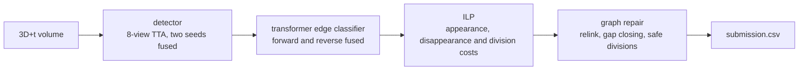

# Cell tracking in 3D+time microscopy

**Kaggle / [Biohub Cell Tracking During Development](https://www.kaggle.com/competitions/biohub-cell-tracking-during-development) / Team ICEQ**

The task is to detect cell nuclei in 3D time-lapse microscopy of zebrafish embryos, link them
across frames and find cell divisions, so that the output graph reconstructs cell lineages.
The score is the adjusted edge Jaccard plus 0.1 times the division Jaccard. Ground truth is
sparse, and the hidden test contains embryos that do not appear in training.

We finished 42nd of 3,947 teams on the private leaderboard, which earned a silver medal. Our
best public score was 0.963. In the last week about 120 teams sat at 0.954 to 0.956 with public notebooks
whose post-processing had been tuned on the training videos.

## Approach

We started from the public pipeline that every 0.94x notebook shares and rewrote it as one
module, [`solution/biohub_clean.py`](solution/biohub_clean.py), with a single `Config` dataclass
instead of about 90 environment variables. In its `public_reference` preset the module
reproduces the public reference notebook exactly: the same edge sets on 8 train videos and
the same official score of 0.9511.

Our gains came from the graph stage, where nuclei are linked between frames and divisions
are accepted, and from a division CNN that we trained. The detector and the two transformer
linkers use public weights.

### Validation with three judges

The public notebooks validate on 4 to 8 training videos that their own weights were trained
on, with a re-implemented division metric that reports 0.25 where the official code gives
0.125. Their authors record a proxy gain of +0.012 that became -0.002 on the leaderboard.
We used three judges instead.

| Judge | What it is | Base score | What it is good for |
|---|---|---:|---|
| OOF | leave-one-embryo-out models, post-processing on their graphs, all 199 videos, official metric | 0.7496 | honest across embryos, but the models are weaker than the submitted ones |
| Stand | public weights on the same 199 videos, official metric | 0.9114 | error levels like the leaderboard; optimistic for the trained parts |
| Public LB | about 40 hidden videos | | final check, with ±0.005 noise between similar submissions |

From 25 September we accepted a change only if it helped on both OOF and the stand. Later we
added a strict stand, where the division CNN is scored on the embryo it was not trained on.
Over the last submissions the stand ran about 0.003 above the leaderboard on average.

### What transferred to the leaderboard

| Change | Gain on the stand | Public LB |
|---|---:|---:|
| Relink by neighbour flow: a nucleus's predicted position is the weighted median shift of confident neighbours within 25 µm, with its own velocity at weight 0 | +0.0279 | 0.946 |
| Division filters (daughter angle at least 105°, symmetry 1.0), a 3D CNN for cell state (normal, mother, daughter) as a veto, and dropped strong detections allowed as second daughters | +0.0359 | 0.948 |
| A likely mother takes a second daughter from a neighbouring track when the CNN sum is at least 1.5 | +0.0046 | 0.949 |
| ILP division costs from the CNN (a fork is cheaper at a likely mother, a track start is costlier at a likely daughter), with ILP forks kept through relinking | +0.0100 | 0.958 |
| Per-frame quantile calibration of the CNN scores and a veto on young forks | +0.0021 (strict) | 0.962 |
| A 50/50 ensemble of the two transformer linkers for every pair | +0.0013 (strict) | 0.963 |

The ILP division costs gained only +0.0004 to +0.0010 out of fold until we noticed that the
public relink step discards every ILP fork. With `relink_keep_forks` the gain was +0.0100 on
the stand, and that submission moved us to 81st of 3,923 on the public leaderboard.

### What did not transfer

- A bundle of two CNN TTA views, a radial veto, a divergence gate and a LightGBM division
  re-ranker. The strict stand promised +0.002, and the leaderboard gave -0.004.
- The public V1284 centre-correction head before the transformer: -0.006 on the leaderboard.
  Its gain on the demo videos came from memorised clicks.
- Rescuing strong detection peaks at track ends: -0.002 on the leaderboard.
- A per-video linker temperature: neutral on the leaderboard.
- Foundation models used without fine-tuning: Grounding DINO as a detector, DINOv2 and
  DINOv3 features for linking, V-JEPA 2, CoTracker3 and SAM2.

### TTA views

The public view list averages 7 distinct views and counts the x-flip twice, while the models
were trained with flips only. On 8 train videos the flip-only sets score higher, which is
expected in-sample because the models saw those videos in exactly those orientations. We
kept the public list.

| TTA views | Score | Adjusted edge Jaccard | Node recall |
|---|---:|---:|---:|
| public list, x-flip counted twice | 0.9511 | 0.9386 | 0.9745 |
| true D4, 8 views | 0.9356 | 0.9245 | 0.9643 |
| the 7 distinct views | 0.9488 | 0.9363 | 0.9684 |
| 4 flips of Y and X | 0.9600 | 0.9475 | 0.9815 |
| 8 flips of Z, Y and X | 0.9568 | 0.9468 | 0.9829 |

## Repository layout

| Path | What |
|---|---|
| `solution/biohub_clean.py` | the whole pipeline: config, inference, ILP, graph repair, CSV writer, CLI |
| `solution/build_notebook.py` | builds the Kaggle notebook from the module and an optional `fixes_v*.json` |
| `solution/biohub_clean.ipynb` | the Kaggle submission notebook |
| `solution/kaggle/fixes_v*.json` | config overrides of each submission; `fixes_v21_sec50.json` scored 0.963 on the public LB |
| `solution/mitosis_cnn.py`, `solution/div_tally.py` | crops and training of the 3D cell-state CNN used for divisions |
| `solution/evaluate_csv.py` | scores submission CSVs on train videos with the official metric |

The notebook reads the public detector, linker and DeepCenter weights from the
`pilkwang/biohub-*` Kaggle datasets, and our cell-state CNN from the `biohub-pp-models` dataset.
